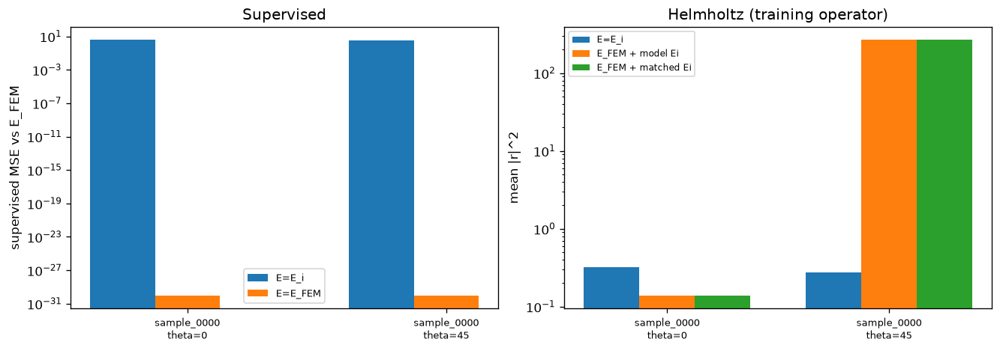
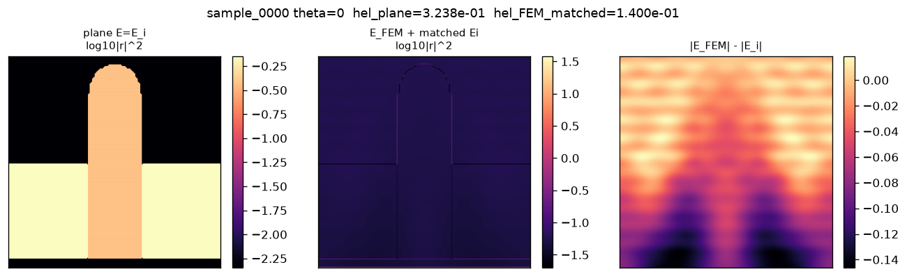
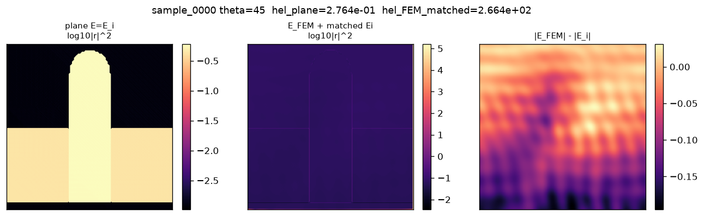
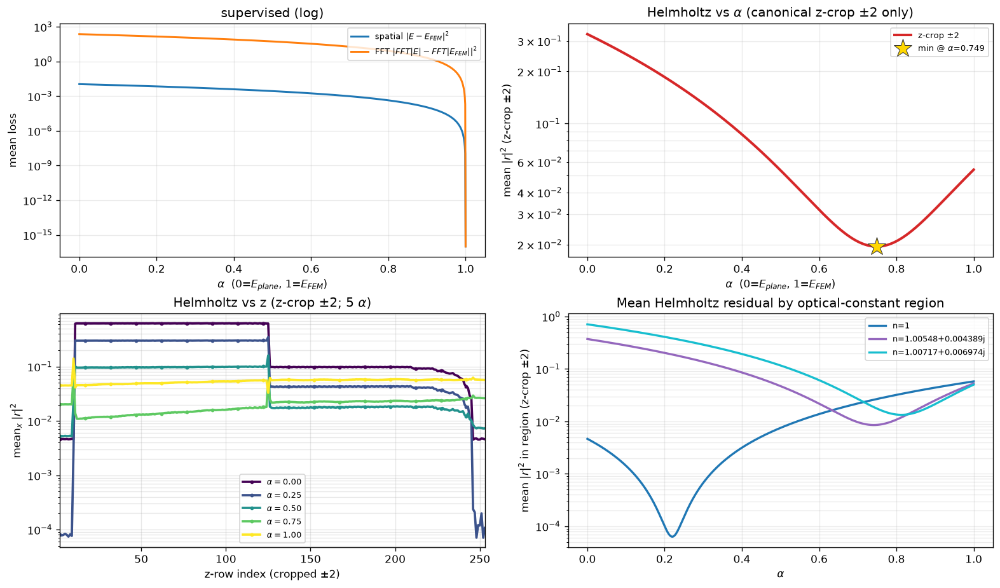
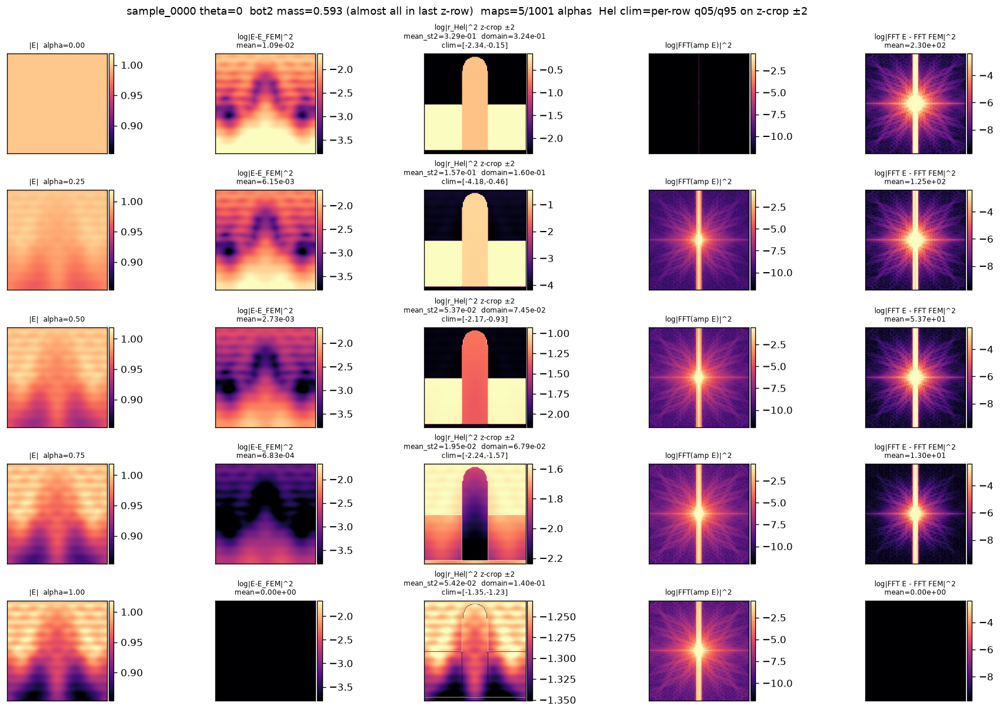
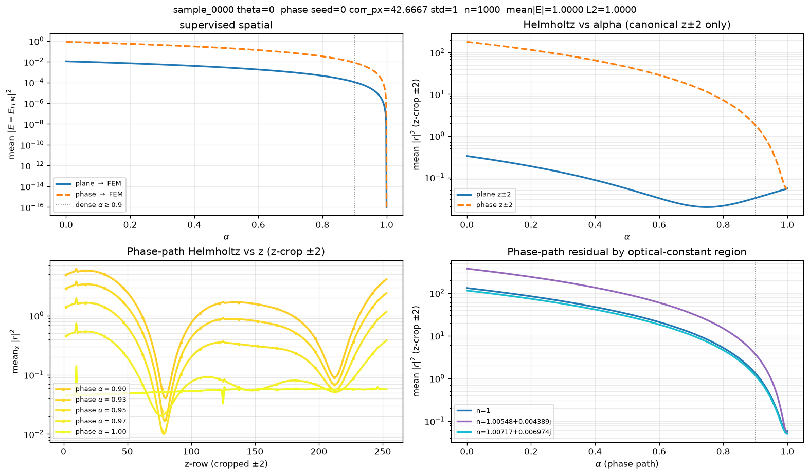
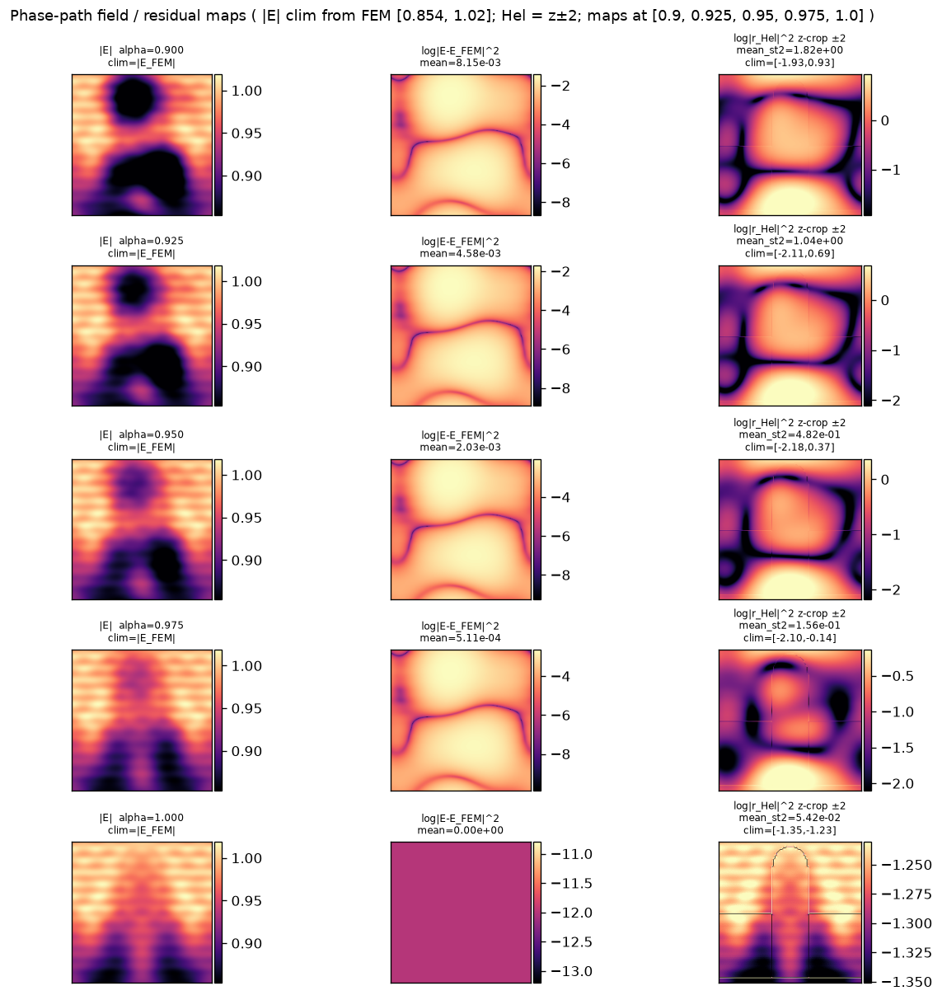
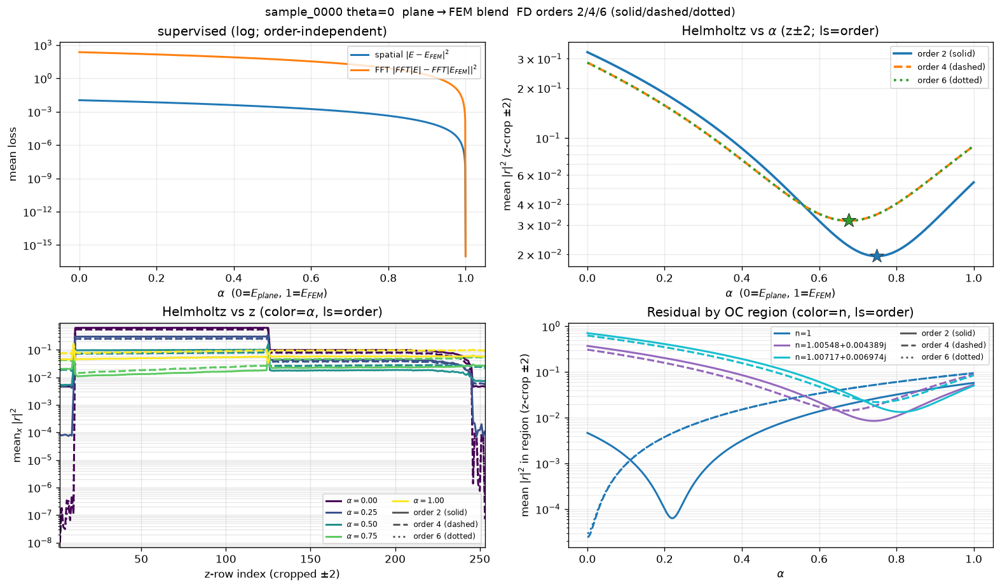

# Notebooks: loss behavior and residual diagnostics

Analysis notebooks for MaxwellNet live here. The main result is a discrete
inconsistency between the FEM total field and the Helmholtz residual used as
the training loss.

| Notebook | Role |
| --- | --- |
| [loss_behavior.ipynb](loss_behavior.ipynb) | Plane-wave vs FEM endpoints, alpha-blend, phase-screen baseline, FD order 2/4/6 |
| [residual_stream.ipynb](residual_stream.ipynb) | INIT vs FIT activations along the UNet path |

Figures for the argument below are in [figures/loss_behavior/](figures/loss_behavior/).
Helpers: `ckpt_io.py`, `unet_activations.py`. Checkpoint `latest.pt` is local
(`*.pt` is gitignored). Dataset: `als-rixs/latent-image-training`
(revision `fixed-dimension`). Geometry used here: `sample_0000` at theta = 0 deg
(TE), with theta = 45 deg as a control.

## Observation

A convex mix of the matched incident plane wave and the FEM solution can score
a **lower Helmholtz residual than FEM itself**.

On `sample_0000`, theta = 0 deg, canonical z-crop +/-2 (the FD-valid band),
`E(alpha) = (1-alpha) E_plane + alpha E_FEM`:

| Field | alpha | mean `|r|^2` (z +/- 2) |
| --- | ---: | ---: |
| matched plane wave | 0.000 | `3.29e-01` |
| **blend minimum (order 2)** | **0.749** | **`1.95e-02`** |
| FEM | 1.000 | `5.42e-02` |

The minimum is not at alpha = 1. About 25% plane wave plus 75% FEM beats FEM by
a factor of ~2.8 on the same discrete operator. That is the quantity MaxwellNet
minimizes.

If the scored operator were the PDE FEM solved, uniqueness of Helmholtz with
these boundary conditions would forbid this. A second distinct field cannot
satisfy the same well-posed BVP, so a convex combination of a non-solution
(`E_plane`) and the unique solution (`E_FEM`) cannot reduce the residual below
the solution. The measured dip means **FEM is not a minimizer of this residual**.
The two "Helmholtz solutions" are not the same object.

## Why uniqueness does not close the gap

Uniqueness is a statement about the **continuous** BVP: given epsilon,
wavenumber, and a complete set of radiation / periodic / interface conditions,
`E` is unique. The training loss is a **different functional**:

```text
r = Laplacian_FD(E) + k^2 * epsilon * E
```

with staggered MaxwellNet kernels, Bloch ghosts in x, and transparent
ghosts in z (the TE training operator on main and `fl/supervised`; not PML),
and a TF/SF split `E = E_i (1 + a)`. FEM solves a weak form on
its own mesh and basis, then the field is resampled onto the Yee grid.

Those are not the same equation. A unique continuous solution can still have a
large discrete residual, and a field that is wrong as a PDE solution can score
better on the FD Laplacian. The blend experiment is a probe of that mismatch,
not a counterexample to uniqueness.

## Evidence

### Endpoints are not the issue

Supervised loss is zero on FEM and nonzero on the plane wave, as it must be.
The Helmholtz residual on FEM is not at floor: matched-incident FEM still
gives mean `|r|^2 = 1.40e-01` over the full domain (`5.42e-02` on z-crop +/-2).
Phase-matching the incident field does not remove the floor.



Interior vs z-edge on matched FEM (theta = 0 deg): interior `5.42e-02`, z-edge
`2.80e+00`. Edges are worse, but the interior is already far from roundoff.
Oblique incidence (theta = 45 deg) is worse still (interior `2.61e+02`).

### Residual maps: FEM is not an eigenfield of this Laplacian

With matched `E_i`, the plane-wave residual is a smooth grating. FEM residual
is spatially structured and large at material interfaces and z-boundaries, not
a uniform discretization rumble.





### The alpha-blend is the decisive test

Dense `alpha` in [0, 1] with phase-matched incident. Supervised loss falls
monotonically to zero at alpha = 1 (spatial and FFT). Helmholtz vs alpha on
z-crop +/-2 is **V-shaped**, minimum at alpha = 0.749, not at FEM.

Helmholtz vs z shows the gain is in the interior bands, not only the crop.
Split by optical-constant region: vacuum `n = 1` has a deep minimum near
alpha ~ 0.22; the weakly absorbing regions minimize closer to
alpha ~ 0.75-0.82. The global dip is a weighted compromise. Vacuum is the
most inconsistent region: an 80% plane-wave mix beats FEM there by orders of
magnitude.



Field and residual maps along the blend (subsampled alpha) show the residual
collapsing in the interior before alpha = 1, then rising again as the field
locks to FEM.



### The dip is specific to the physical plane wave

Replace alpha = 0 with a fringe-matched phase screen on the same incident,
`E = E_i exp(i phi)`, `phi` a smooth GP at the plane-wave period. Helmholtz at
alpha = 0 jumps from `3.3e-01` (plane) to `1.8e+02` (phase). The blend into FEM
is then monotonic: no interior minimum. A generic same-magnitude field does
not beat FEM. The cheap residual directions are aligned with the incident
plane wave, i.e. with the homogeneous (or near-homogeneous) Helmholtz kernel.





### Higher-order FD does not restore FEM as the minimizer

Staggered orders 2 / 4 / 6 (solid / dashed / dotted) on the same 2x2 panel.
Plane-wave Laplacian validator vs analytic `-(kx^2 + kz^2)`:

| order | mean relative error | max relative error |
| ---: | ---: | ---: |
| 2 | `1.73e-03` | `1.75e-03` |
| 4 | `7.25e-05` | `2.42e-04` |
| 6 | `8.01e-05` | `2.60e-04` |

The operator is more accurate on a resolved plane wave at order 4/6. On the
FEM blend it does **not** move the minimum to alpha = 1. Order 2: alpha = 0.749,
`1.95e-02`. Orders 4 and 6 overlap: alpha = 0.676, `~3.18e-02`. FEM residual
rises with order. FEM is not an eigenfield of this family of discrete
Laplacians; raising the order does not make the FEM grid function consistent
with them.



## What this implies

MaxwellNet is trained against `r`, not against FEM. If FEM is not a minimizer
of `r`, then:

1. Driving `r -> 0` will not recover FEM (and should not, if FEM is the wrong
   discrete solution for this operator).
2. The discrete null space includes a plane-wave-like component. A network
   initialized near `a = 0` (Born / incident) can sit closer to a low-`r`
   mix than to FEM.
3. Supervised-to-FEM training and physics-loss training are optimizing
   different targets. Comparing them as "the same Helmholtz problem" is
   incorrect until the operators match.

## Open analysis

These are the remaining hypotheses; uniqueness of the continuous BVP is not
one of them.

1. **Grid / interpolation.** FEM `E` resampled onto the Yee cell is not the
   staggered field the FD operator expects (centering, epsilon averaging).
2. **Boundary model.** FEM radiation / periodicity vs Bloch ghosts plus
   transparent-z (FFT) ghosts. Residual maps concentrate at z-edges; the
   interior dip remains after dropping +/-2 rows.
3. **Incident / TF-SF.** Matched `E_i` fixes global phase. A residual
   plane-wave component in vacuum still looks like a homogeneous solution of
   `Laplacian + k^2`.
4. **epsilon on the FD grid.** Staircasing and complex-n regions vs FEM's weak
   form. Vacuum (`n = 1`) showing the deepest alpha dip is the puzzle: there
   epsilon is trivial, so the mismatch is in the Laplacian / BCs, not the
   material model.
5. **Dispersion.** Even order 6 is a different dispersion relation than FEM.
   A 20-30% plane-wave mix can cancel the leading FD phase error on this
   geometry.

Next measurements that would distinguish these: evaluate `r` on FEM using
FEM's own weak residual; compare FD residual of an FD reference solve on the
same grid; restrict the blend to vacuum-only vs scatterer-only support;
replace transparent-z with a different z BC and re-trace alpha.

## How to regenerate

From `notebooks/`, run [loss_behavior.ipynb](loss_behavior.ipynb) top to
bottom. Section 6 is the order-2 blend; section 7 is the phase-screen control;
section 8 overlays FD orders 2/4/6 (linestyle) on one panel. Order 2 uses
`maxwell_losses/helmholtz_checker.py` unchanged. Orders 4 and 6 inject
staggered kernels (`staggered_fd.py`) through
`helmholtz_checker_o4.py` / `helmholtz_checker_o6.py`.
